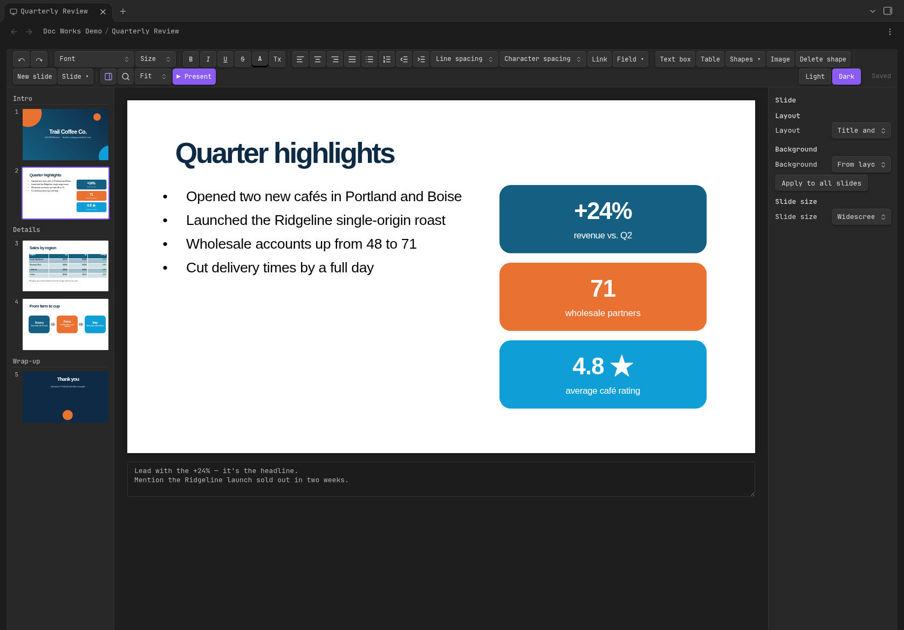
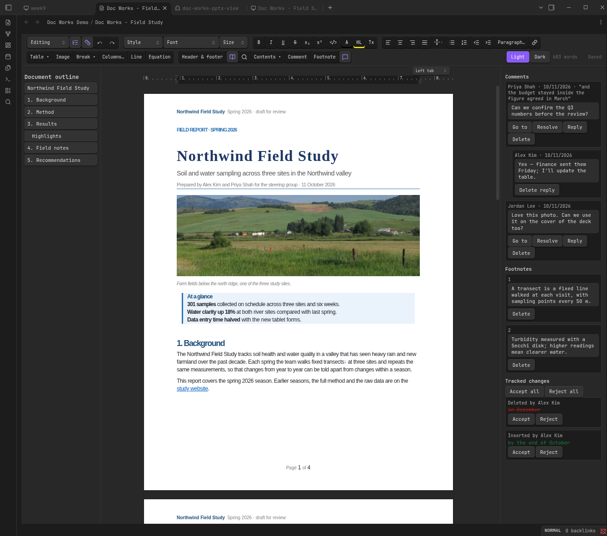

# Doc Works

**Open and edit Word, PowerPoint and Excel files right inside Obsidian.**

[](https://obsidian.md/plugins?id=doc-works)
[](https://github.com/zarnuq/DocWorks/releases/latest)
[](https://github.com/zarnuq/DocWorks/releases/latest)
[](LICENSE)



- **Looks like PowerPoint, Word and Excel.** Themes, layouts, shapes, SmartArt, tables, document styles and cell formats render faithfully, even without Office fonts.
- **Doesn't break your files.** Only what you edit is rewritten; everything else is saved back byte-for-byte.
- **Self-contained.** No Office, no LibreOffice, no system dependencies. Works offline.

If it saves you a trip to Office, please ⭐ the repo.



## Features

**Word:** styles, fonts and formatting, lists, links, tables (merge, borders, header rows), draggable floating pictures with wrapping and text spacing, page view (true page size, breaks inside tables and paragraphs, including column sections, headers and footers with pictures and page numbers), comment replies and resolve/reopen, footnotes, table of contents, suggestion mode and tracked changes (accept / reject), document outline, ruler for margins, indents and tab stops, find and replace, word count.

Choose **Suggesting** from the editing mode menu to record proposed text and formatting edits. Use the review panel to accept or reject changes and reply to or resolve comments. The outline and ruler buttons toggle navigation and page controls; drag ruler handles to adjust margins and indents, or click the ruler to add a tab stop. Floating pictures have a move handle and text spacing control. Pages fit the available space when sidebars are open.

**PowerPoint:** text editing on the slide, all 187 preset shapes, connectors, group / align / distribute with snapping, tables with table styles, picture crop, layouts, backgrounds, slide size, sections, speaker notes, slideshow with presenter view, slide transitions and object animations, find and replace, zoom, fonts embedded in the deck (e.g. from Google Slides).

Click **Motion** to add a slide transition or animate a selected object with appear, fade, fly, zoom or spin. Choose on-click, with-previous or after-previous playback, animate text by paragraph, set duration and delay, reorder or remove effects, and use **Play preview** to check them in present mode. Changes save into the presentation and support undo/redo. Imported compound steps retain their original effects; expand individual effects to edit timing or motion paths. The **Slide** dropdown includes New slide and the other slide actions.

**Excel:** a fast grid that stays smooth on sheets with 100,000+ cells, frozen rows and columns, merged cells, number formats (currency, percent, dates, custom codes with colors), fonts, fills, borders, alignment and wrapping, pictures, hidden rows / columns / sheets. Type values or formulas (click cells to insert references), and dependent cells recalculate across sheets with about 90 common functions (SUM, IF, VLOOKUP, XLOOKUP, INDEX / MATCH, SUMIFS, COUNTIFS, TEXT, DATE, ...). Copy and paste within the grid and to other apps, fill handle with number series, sort, filters, insert / delete / hide / resize rows and columns, freeze panes, merge, add / rename / duplicate / move / hide sheets, find and replace, name box, Export to PDF. Formulas using functions it can't calculate keep the file's result and are marked; Excel recalculates them on open.

**Not yet in spreadsheets:** charts, comments, conditional formatting and data validation are kept in the file but not shown or edited.

**All:** New presentation / New document / New spreadsheet commands, undo / redo, autosave, light and dark themes.

**Theme** edits theme colors/fonts and opens the master or layout canvas. Create custom layouts and add title/body placeholders, then apply them from the slide layout selector.

**Chart** inserts column, line, pie, doughnut or area charts with an editable data grid. Select a chart and click **Edit chart data** to change categories, series names and values; embedded workbook cells are updated too. Imported chart formatting is preserved. Externally linked workbooks and named/multi-level ranges need conversion to embedded cell ranges in Office first. Charts and SmartArt can be copied between presentations with their linked resources.

**Audio/video** embeds MP4, WebM, MP3, WAV, Ogg or M4A files. Select media to choose automatic playback or looping; present mode provides playback controls. Playback depends on the codecs supported by the device.

**Not yet:** editing SmartArt data, advanced chart formatting, and complete Office layout fidelity for complex floating objects and mixed section layouts.

## Install

- **Community plugins** (once listed): search "Doc Works".
- **BRAT:** add `zarnuq/DocWorks`.
- **Manual:** copy `main.js`, `manifest.json` and `styles.css` from the [latest release](https://github.com/zarnuq/DocWorks/releases) into `<vault>/.obsidian/plugins/doc-works/` and enable it.

If another plugin already opens `.docx`, `.pptx` or `.xlsx`, disable it to use Doc Works for that type.

## Contributing

Found a file that renders wrong? Open an issue with the file or a screenshot next to Office's rendering. PRs welcome; see `CLAUDE.md` for the architecture.

```bash
npm run dev    # watch build
npm test       # vitest
npm run lint   # Obsidian plugin rules
```

## License

GPL-3.0
