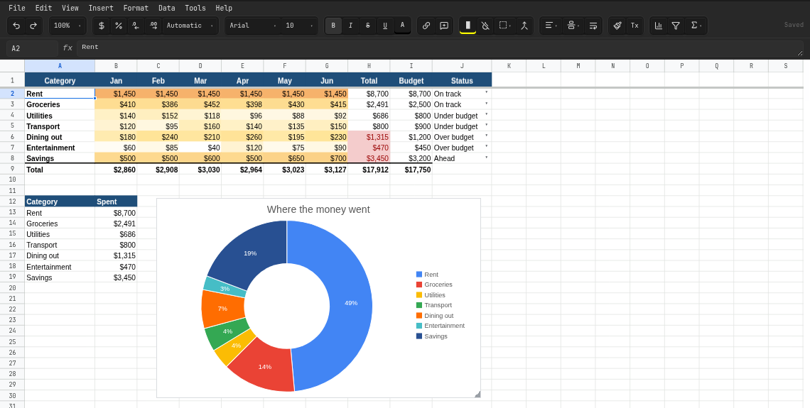

# Doc Works

**Open and edit Word, PowerPoint and Excel files right inside Obsidian.**

[](https://obsidian.md/plugins?id=doc-works)
[](https://github.com/zarnuq/DocWorks/releases/latest)
[](https://github.com/zarnuq/DocWorks/releases/latest)
[](LICENSE)


- **Looks like PowerPoint, Word and Excel.** Themes, layouts, shapes, SmartArt, tables, document styles and cell formats render faithfully, even without Office fonts.
- **Doesn't break your files.** Only what you edit is rewritten; everything else is saved back byte-for-byte.
- **Self-contained.** No Office, no LibreOffice, no system dependencies. Works offline.

If it saves you a trip to Office, please ⭐ the repo.




## Features

### Documents (.docx)

- Word-accurate pages: real page sizes per section, Word's line heights and font widths, columns
- Styles, fonts, lists, paragraph spacing, borders and shading
- Tables with merged cells, borders, shading and header rows that break across pages
- Pictures with wrapping and dragging; shapes, text boxes, charts and equations
- Headers and footers per section, with pictures, page numbers and watermarks
- Suggesting mode and tracked changes from Word (accept / reject)
- Comments with replies and resolve / reopen
- Footnotes, table of contents, links
- Document outline and a ruler for margins, indents and tab stops
- Fonts embedded in the file are used

### Presentations (.pptx)

- Faithful slides: themes, masters, layouts, backgrounds, SmartArt and all 187 preset shapes
- Fonts embedded in the deck are used, including Google Slides' exports
- Text editing on the slide with bullets, numbering and autofit
- Shapes, connectors, group / align / distribute with snapping
- Tables with table styles, pictures with crop and colour adjustments, charts
- Custom themes and layouts, slide size, sections, hidden slides
- Transitions and object animations
- Slideshow with presenter view and speaker notes
- Comment threads, audio and video
- Copy, cut and paste slides between decks, keeping their look

### Spreadsheets (.xlsx)

- Fast grid that stays smooth on sheets with 100,000+ cells
- Formulas with about 90 functions, recalculated live across sheets
- Google Sheets functions and Google exports (QUERY, ARRAYFORMULA, REGEX…)
- Number formats, fonts, fills, borders, alignment, merges, frozen panes
- Conditional formatting, icon sets, data bars, dropdowns and validation
- Charts, pictures, sparklines and pivot tables
- Notes and threaded comments
- Sort, filters, row / column groups, named ranges
- Sheet protection with locked cells and passwords
- Formulas it can't calculate keep the file's saved result

### Everywhere

- Saves only what you change; the rest of the file is kept byte for byte
- Google Docs / Slides / Sheets-style menus and toolbars
- Undo / redo, autosave with retry, light and dark page themes
- Find and replace, including speaker notes, comments and cell notes
- Export to PDF; slides to PNG, sheets to CSV
- New document / presentation / spreadsheet commands
- No Office or other software needed; works offline and on mobile

### Notes and Markdown

- **Export current note to .docx:** headings, lists, tasks, callouts, code, tables, equations, pictures and links back to Obsidian
- **Export to Markdown** from a Word file, keeping frontmatter, tasks, callouts and code languages from notes exported here
- Embed a file in a note: `![[report.docx]]`, `![[deck.pptx#3]]`, `![[budget.xlsx#Sheet2]]`

## Install

- **Community plugins** (once listed): search "Doc Works".
- **BRAT:** add `zarnuq/DocWorks`.
- **Manual:** copy `main.js`, `manifest.json` and `styles.css` from the [latest release](https://github.com/zarnuq/DocWorks/releases) into `<vault>/.obsidian/plugins/doc-works/` and enable it.

If another plugin already opens `.docx`, `.pptx` or `.xlsx`, disable it to use Doc Works for that type.

## Contributing

Found a file that renders wrong? Open an issue with the file or a screenshot next to Office's rendering. PRs welcome; see `CLAUDE.md` for the architecture.

```bash
npm run dev    # watch build
npm test       # vitest
npm run lint   # Obsidian plugin rules
```

## License

GPL-3.0
